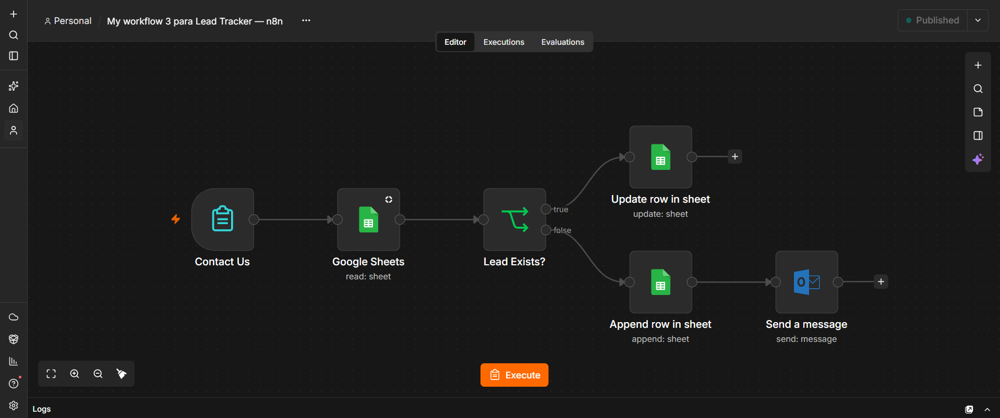
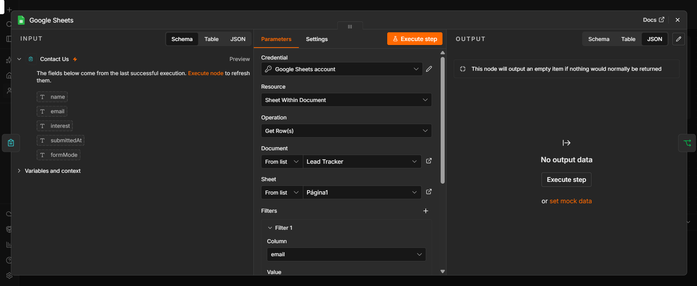
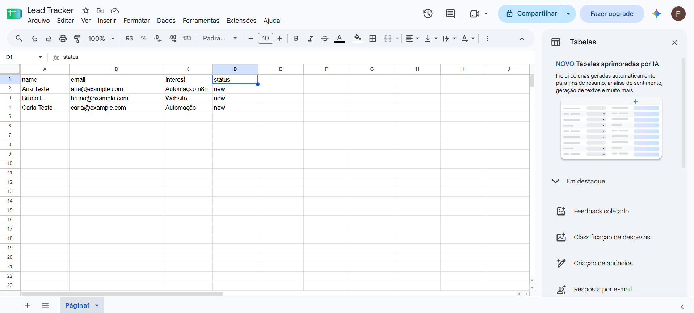
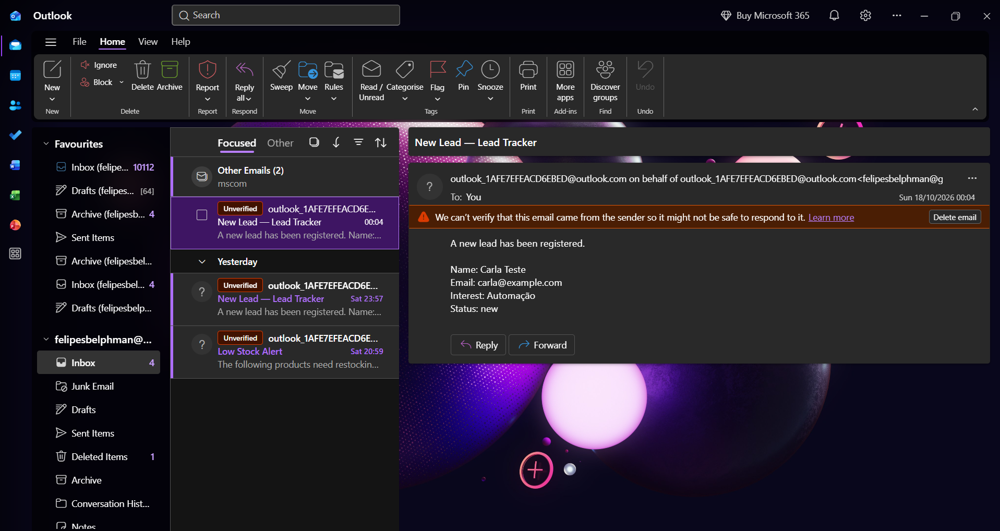

# Lead Tracker — n8n

Portfolio demonstration using sample contacts. Captures form submissions, looks up an exact email match in Google Sheets, updates existing records, and emails an internal recipient only for new leads.

## Workflow

- Contact Us: required name, email and interest fields.
- Google Sheets: search by email; Always Output Data keeps the workflow running when no match exists.
- Lead Exists?: route matching records to Update Row, otherwise Append Row.
- Update Row: update name, email and interest using row_number; preserve existing status.
- Append Row: create a contact with status `new`.
- Microsoft Outlook: notify the configured internal recipient after a new record is added.

## Setup

1. Import `lead-tracker.json` into n8n as a separate workflow. The export is inactive.
2. Import `sample-leads.csv` into Google Sheets or create headers: name, email, interest, status. Name the sheet tab Página1, or select your own tab in all three Google Sheets nodes.
3. Connect your Google Sheets credentials to all three Sheets nodes and select your document and sheet. Replace YOUR_SPREADSHEET_ID.
4. Connect Microsoft Outlook credentials and replace your-email@example.com with the internal notification recipient.
5. Test both branches before publishing. Publish and use the form Production URL for automatic submissions.

## Validation observed in the original workflow

- New contact: appended to the spreadsheet and email received.
- Existing email: updated the same row; append and email nodes did not run.
- Published form: Carla Teste appeared in the spreadsheet and notification arrived.

The sanitized export has been checked as JSON and for preserved connections; it has not been imported or executed independently after sanitization.

## Limits

Email matching is exact; case and whitespace normalization are not implemented. The lookup and append are separate operations, so simultaneous submissions can create duplicates. Existing duplicates are not cleaned up. This is a learning/portfolio workflow, not a transactional CRM. Credential references, original spreadsheet identifiers, recipient address and instance metadata were removed from this public copy.

## Screenshots

Add your sanitized screenshots as workflow.png, leads.png and email-alert.png. No screenshots are bundled in this package.

## Screenshots

### Automation Workflow
Captures leads and routes them to registration or update.

### Email Lookup
Checks Google Sheets for an existing contact using their email.

### Lead Spreadsheet
Stores contact details and updates existing records.

### Email Notification
Sends an internal notification when a new lead is registered.

